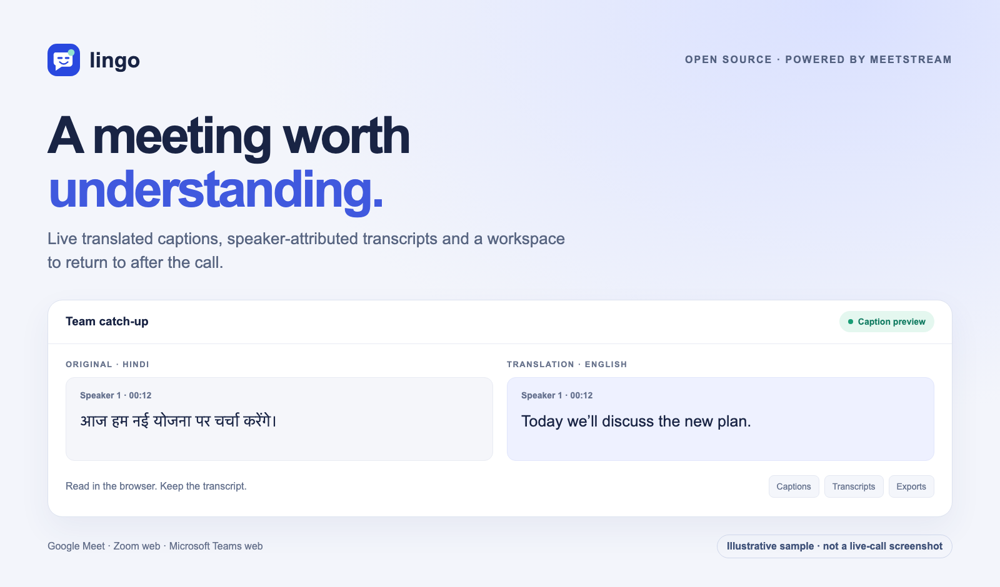
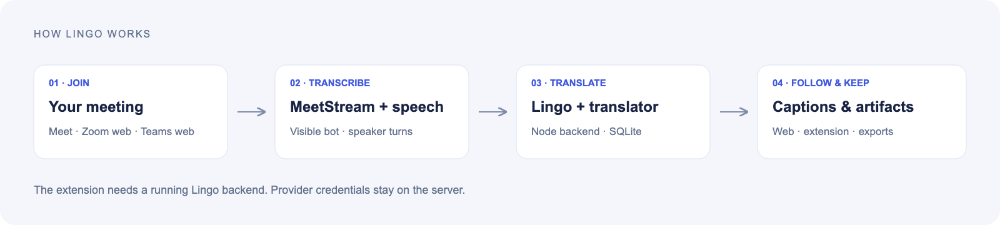

# Lingo

<p align="center">
  
</p>

### Follow the conversation in your language.

Live translated captions for **Google Meet, Zoom web and Microsoft Teams web**, powered by [MeetStream](https://meetstream.ai). Read along during the call, hear selected translations aloud, and come back to a searchable transcript when it’s over.

**[Get started](#get-started)** · **[Install the extension](#take-captions-into-your-meeting)** · **[Self-host](docs/HOSTING.md)** · **[Report a bug](https://github.com/meetstream-ai/lingo/issues)**

Open source · MIT licensed · Node.js 24+ · Chrome extension included

## One call. More ways to follow along.

| During the meeting | After the meeting |
| --- | --- |
| Read translated captions in the web app or a movable Chrome overlay. | Search original and translated transcripts, with speaker attribution. |
| Choose up to eight output languages per recording and switch caption languages during the call. | Revisit recordings, notes, action items and a post-call excerpt overview. |
| See which speech and translation providers are handling the call. | Export captions as VTT/SRT and transcripts as HTML, Markdown, text or JSON. |
| Select **Listen** to hear translated text read aloud. | Save to Google Drive, share to Slack or Discord, or prepare a Gmail draft. |

**Listen** uses Google Cloud Text-to-Speech, with a matching browser voice as a fallback when available. It plays selected text on demand. Post-call excerpt overviews are created after final transcripts and translations are ready; JigsawStack AI summaries are an optional separate action.

## Get started

Install [Node.js 24 or newer](https://nodejs.org/) and Git, then run:

```sh
git clone https://github.com/meetstream-ai/lingo.git
cd lingo
npm start
```

Open **[localhost:3000](http://localhost:3000)** and try the built-in Hindi/Tamil sample. **The sample needs no provider accounts.**

The launcher installs missing dependencies, creates your local `.env`, packages the extension and starts the server. Stop it with **Ctrl+C**, or run `npm stop` from another terminal in the same checkout.

**Ready for a real call?** Follow the [quickstart](QUICKSTART.md) to configure MeetStream, a translator and a public HTTPS callback URL. Provider accounts may require billing and available quota. Keep the local app running during your meeting, or [host the backend](docs/HOSTING.md).

## Take captions into your meeting

1. Start Lingo and configure your connections using the [quickstart](QUICKSTART.md).
2. Download the extension ZIP from the running app, extract it, and load the extracted `extension/` folder in Chrome using **Extensions → Developer mode → Load unpacked**.
3. Connect the extension to your Lingo workspace, then open a supported meeting invitation in Chrome and start captions from the extension. Admit the visible meeting bot when prompted.

The overlay stays on the meeting page while the website keeps your transcripts and post-call artifacts. **The extension needs a running Lingo backend.** Installing it alone doesn’t connect speech or translation services.

Use a meeting invitation, not the provider’s homepage. Google Meet invitation and `/meet/` URLs, numeric Zoom invitations and web join/start URLs, and Teams numeric or encoded `meetup-join` invitations are supported. For a Zoom personal `/my/` room, copy its numeric invitation from meeting details. The Chrome overlay runs in browser meetings; desktop Zoom and Teams users can follow captions in Lingo’s web app separately.

## From meeting audio to translated captions



A visible MeetStream bot receives meeting audio after admission. The speech provider sends speaker-attributed turns to Lingo, which stores originals in SQLite and runs text translation. Captions appear in the web app and Chrome overlay. After the call, a worker retrieves final transcripts and recordings, completes translations and saves excerpt overviews.

The extension polls for captions every **1.5 seconds**. That is a polling interval, not an end-to-end latency promise: recognition, translation and network time add delay. It does not record your microphone or scrape the meeting page’s captions.

## Pick the services that fit your meeting

Speech recognition and translation are configured separately. Connect speech providers in the **same MeetStream workspace** as your API key; configure text translation in Lingo’s **Connections** or `.env`.

| Service | Available adapters |
| --- | --- |
| Meeting bot | MeetStream |
| Speech recognition | MeetStream, Deepgram, AssemblyAI, JigsawStack |
| Text translation | Google Cloud Translation, Azure Translator, JigsawStack, DeepL |
| Read-aloud playback | Google Cloud Text-to-Speech; matching browser voices when available |
| Optional AI summary | JigsawStack |
| Save and share | Google Drive, Slack, Discord, Gmail drafts |
| Meeting titles | Read-only Google Calendar lookup |

Language coverage varies by adapter. Lingo shows each adapter’s supported catalog; it does not promise every language with every provider.

<details>
<summary><strong>Provider limits and language changes</strong></summary>

- Native MeetStream live recognition uses automatic language detection. Deepgram live requires a fixed spoken language.
- AssemblyAI live through this integration is English-only. JigsawStack live is Google Meet-only.
- The DeepL adapter exposes a conservative 32-code subset. Use Google, Azure or JigsawStack for Hindi/Tamil translation targets.
- Changing the output language changes the captions you read. Changing the spoken recognition language for supported providers restarts the bot as a linked recording part, with a caption gap and possible readmission. Exports cover one recording part at a time.
- Google Cloud Text-to-Speech requires its API, billing and suitable key permissions. If cloud playback fails, a matching browser voice must be available for fallback playback.
- Sharing is user initiated. Gmail creates drafts; it does not send mail automatically.

</details>

## Keep useful meeting artifacts

Download **VTT/SRT captions**, **HTML, Markdown, text or JSON transcripts**, recordings and portable meeting archives. Use print-to-PDF for a printable copy. Export filenames include the meeting name and timestamp, so files are easier to identify later.

Original text and translations stay together in the workspace. Speaker attribution follows the information supplied by the speech provider. For a real deployment, use the [acceptance checklist](docs/ACCEPTANCE.md) to check your language pairs, timing and exported artifacts with an actual call.

## Run locally or host your own workspace

Lingo is a Node/Express application with SQLite storage. Deploy the **backend**, with HTTPS and persistent writable storage, using one process/replica. The repository includes a Dockerfile, Compose example and [hosting guide](docs/HOSTING.md).

The local terminal and computer must stay running for local use. Hosted deployments need a strong workspace password, session secret and correct public origin. Services that sleep or discard local storage cannot reliably keep this SQLite workspace available and retain its data.

Keep `.env` and `data/` private. Browser-saved connections, transcripts and recordings can contain sensitive information. Provider keys stay on the backend; extension grants expire after 24 hours and can be revoked in Connections. The shared workspace password is intended for a trusted workspace, not a complete multi-tenant permission system.

<details>
<summary><strong>Configuration and backups</strong></summary>

Use [.env.example](.env.example) for supported variables. Set `APP_PASSWORD` to protect the workspace and enable browser connection editing. Public tunneling requires a password and session secret; the launcher generates missing values in your private `.env`. Read the password there when signing in. Restart after environment changes.

SQLite defaults to `data/meetings.sqlite`; browser-saved credentials live in `data/connections.json`. Protect the data directory and backups. Use SQLite’s online backup mechanism, or stop the app before copying database files; copying the main database alone during writes can lose WAL data.

For hosted deployments, use Node 24+, `NODE_ENV=production`, `HOST=0.0.0.0`, `PUBLIC_ORIGIN`, and a `DATABASE_PATH` on the persistent volume. Disable ngrok, then run `npm run check:hosting`. The health endpoint is `/healthz`.

</details>

## Build and contribute

```sh
npm ci
npm test
npx playwright install --with-deps chromium firefox webkit
npm run test:e2e
npm run build
```

`npm run dev` watches the backend. `npm run build` checks JavaScript syntax, packages the extension and source ZIPs, and creates a runnable `dist/` distribution. The running app serves downloads at `/extension.zip` and `/starter-kit.zip`.

Automated tests use controlled fixtures. Check real speech quality, account permissions, bot admission and latency with your chosen providers before relying on a live deployment.

| Directory | What’s inside |
| --- | --- |
| `server/` | API, authentication, webhooks, SQLite jobs and provider adapters |
| `public/` | Homepage, workspace and setup guides |
| `extension/` | Chrome Manifest V3 popup and caption overlay |
| `scripts/` | Start/stop, packaging, build and diagnostics |
| `test/` | Backend and isolated browser/extension tests |
| `docs/` | Hosting, acceptance checklist and references |
| `deploy/` | Hosting environment examples |

Found a bug? [Open an issue](https://github.com/meetstream-ai/lingo/issues) with reproduction steps, expected behavior and sanitized errors. Contributions are welcome. Never include credentials, signed recording URLs or private meeting transcripts.

## License

[MIT](LICENSE). Lingo’s artwork is original to this project. Provider names identify integrations.
